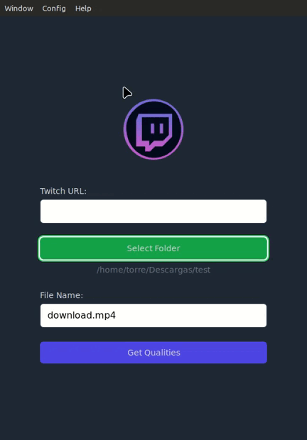

# Twitch Downloader


## About
Twitch Downloader is a free utility made to download Twitch content (streams, videos, highlights, clips).

## Features

- Download live streams, VODs, highlights, and clips
- Quality selector for each content type
- Cancel a download, or stop a live recording and keep what was captured
- Dark and light theme
- 6 languages: English, Spanish, Portuguese, French, German, Italian
- Configurable download folder
- Open file in file manager after download
- Cross-platform (Linux, macOS, Windows)

## Prerequisites

- [Node.js](https://nodejs.org/) (v20.19+ or v22.12+)
- [Rust](https://www.rust-lang.org/tools/install)
- System dependencies for Tauri: see [Tauri prerequisites](https://v2.tauri.app/start/prerequisites/)

## How to execute

### Development

```
npm install
npm run tauri dev
```

### Build for production

```
npm run tauri build
```

It will open a new window with the GUI. Enter the URL of the stream, video, highlight or clip you want to download. Then, select the folder, file name and click on Get Qualities button. Select the quality you want to download and click on Download.



## Tests

```
npm test
```

## Donate
If you want to support the project, you can buy me a coffee. Thanks!

[](https://www.buymeacoffee.com/sergioalmela)

## Technologies used
- [](https://tauri.app/)
- [](https://www.rust-lang.org/)
- [](https://www.typescriptlang.org/)
- [](https://preactjs.com/)
- [](https://vite.dev/)
- [](https://tailwindcss.com/)
- [](https://vitest.dev/)
- [](https://biomejs.dev/)

## Issues

Feel free to submit issues and enhancement requests here: [Report Issue](https://github.com/sergioalmela/TwitchDownloader/issues)

Before posting an issue, be sure to include (if applicable):
- URL of the content to download
- Path to save the file
- Resolution of the file to download

## Contributing

1. **Fork** the repo on GitHub
2. **Clone** the project to your own machine
3. **Commit** changes to your own branch
4. **Push** your work back up to your fork
5. Submit a **Pull request** so that we can review your changes

NOTE: Be sure to merge the latest from "upstream" before making a pull request!

Any contribution to the localization of the app is welcome. You can find the localization files in the `src/locales` folder. You can use the `en.json` file as example.
